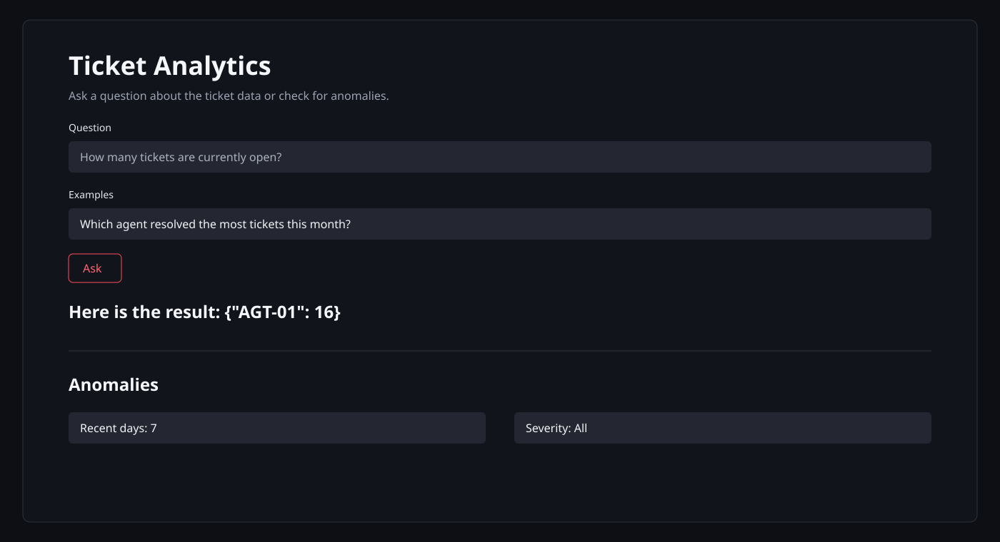

# Ticket Analytics

An AI-assisted customer support analytics system for asking questions about ticket data, exploring the result, and detecting operational anomalies.



## What It Does

- Loads and validates ticket records from `data/support_tickets.csv`.
- Answers natural-language questions through a Streamlit interface.
- Uses a safe, AST-validated pandas expression path for generated analytics.
- Runs without an external model by using the built-in mock provider.
- Optionally calls Groq for expression generation and concise answers.
- Detects overdue high-priority tickets, resolution-time outliers, and invalid timing data.
- Exposes health, query, anomaly, and paginated ticket APIs.


  
## API Endpoints

| Method | Endpoint | Purpose |
| --- | --- | --- |
| `GET` | `/health` | Service status, dataset state, row count, and LLM configuration |
| `POST` | `/query` | Answer a natural-language ticket question |
| `GET` | `/anomalies` | Return detected anomalies, optionally filtered by days and severity |
| `GET` | `/tickets` | Return paginated ticket records |

Example query request:

```bash
curl -X POST http://localhost:8000/query ^
  -H "Content-Type: application/json" ^
  -d "{\"question\":\"How many tickets are currently open?\"}"
```

On macOS/Linux, replace the `^` line continuations with `\\`.

## Quick Start

### Local Python

Python 3.12 or newer is recommended.

```bash
python -m venv .venv
.venv\Scripts\activate
pip install -r requirements.txt
```

Start the API:

```bash
python -m uvicorn app.main:app --reload --port 8000
```

In a second terminal, start the UI:

```bash
streamlit run ui/app.py
```

Open:

- UI: <http://localhost:8501>
- API docs: <http://localhost:8000/docs>
- Health check: <http://localhost:8000/health>

### Docker Compose

```bash
docker compose up --build
```

The compose service exposes both the API and UI ports. The `data/` directory is mounted read-only into the container.

## Configuration

Create a local `.env` file from this template:

```dotenv
LLM_PROVIDER=mock
LLM_MODEL=llama-3.3-70b-versatile
# Required only when LLM_PROVIDER=groq
GROQ_API_KEY=your_groq_api_key
```

Supported settings:

| Variable | Default | Description |
| --- | --- | --- |
| `LLM_PROVIDER` | `mock` | `mock` for local deterministic behavior or `groq` for the hosted model path |
| `LLM_MODEL` | `llama-3.3-70b-versatile` | Model sent to the Groq-compatible endpoint |
| `GROQ_API_KEY` | unset | API credential required by the Groq provider |
| `DATA_PATH` | `data/support_tickets.csv` | Ticket CSV location |
| `REFERENCE_TIME` | latest ticket timestamp | Reference time used for age and date filters |
| `API_URL` | `http://localhost:8000` | API base URL used by Streamlit |
| `API_PORT` | `8000` | FastAPI port used by `run.py` |
| `RUN_UI` | `0` | Set to `1` to start Streamlit from `run.py` |

Never commit `.env` or expose API keys in documentation, screenshots, logs, or test fixtures.

## Data Contract

The CSV must contain these columns:

```text
ticket_id, created_at, category, priority, status,
response_time_hrs, resolution_time_hrs, agent_id,
customer_rating, issue_summary
```

Allowed values are validated for `category`, `priority`, and `status`. The loader also derives `is_resolved` and `age_hrs` for analytics.

## Anomaly Rules

- `unresolved_priority_over_24h`: unresolved High or Critical tickets older than 24 hours.
- `resolution_time_iqr_outlier`: resolution times above the priority-specific IQR upper bound.
- `resolution_before_response`: resolved tickets whose resolution time is lower than response time.

Filter anomalies with query parameters such as:

```text
/anomalies?days=7&severity=critical
```

## Testing

```bash
pytest -q
```

The test suite covers data validation, query behavior, anomaly rules, and API responses.

## Project Layout

```text
.
├── app/
│   ├── anomalies.py     # Rule-based anomaly detection
│   ├── data.py          # CSV loading and validation
│   ├── llm.py           # Mock and Groq-compatible LLM client
│   ├── main.py          # FastAPI application and endpoints
│   └── nl_query.py      # Query interpretation and safe evaluation
├── data/
│   └── support_tickets.csv
├── docs/
│   ├── architecture.mmd # Editable architecture diagram
│   └── ui-preview.svg    # README UI preview
├── tests/
├── ui/app.py            # Streamlit frontend
├── Dockerfile
├── docker-compose.yml
└── run.py               # API entry point with optional UI startup
```
